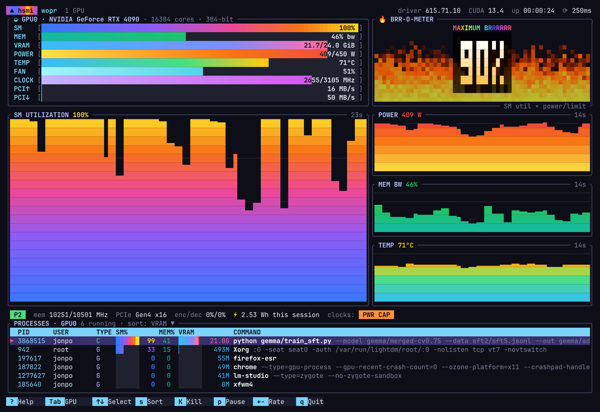
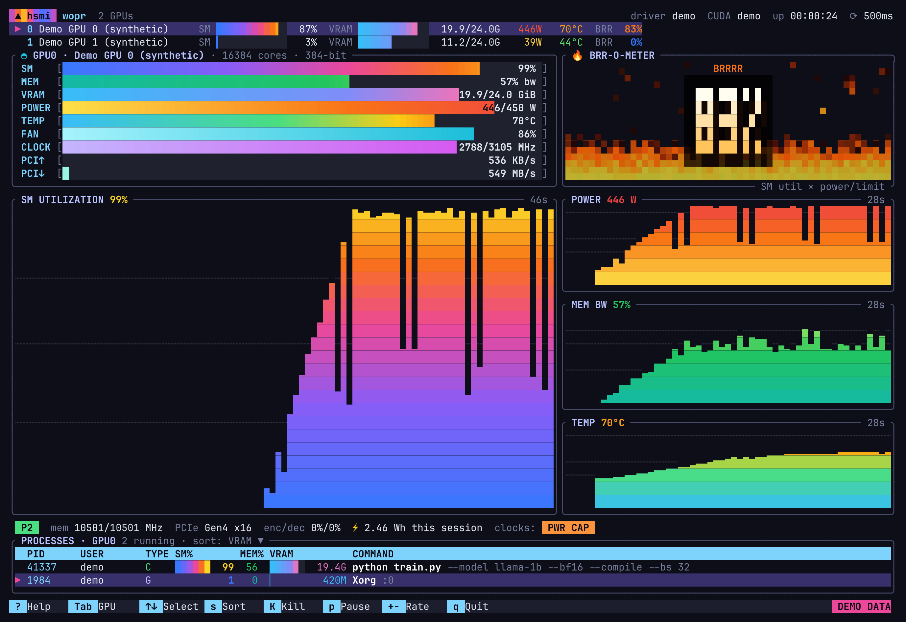
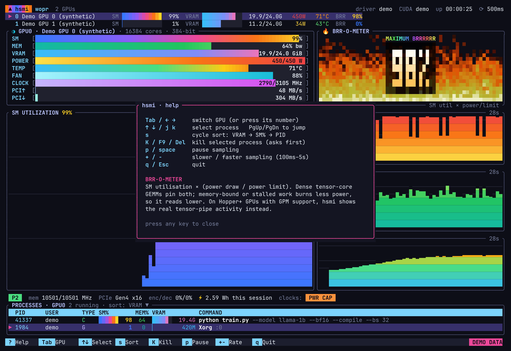

# hsmi

**htop for your GPUs.** The prettiest `watch nvidia-smi` we could make: watch the GEMMs go brrr.



<sub>Live on an RTX 4090 during a Gemma SFT run.</sub>

```
cargo install --path .
hsmi            # live, via NVML
hsmi --demo     # synthetic 2-GPU training run, no GPU needed
hsmi -i 250     # sample every 250 ms (default 500)
```

## What's on screen

| Panel | What it shows |
|---|---|
| **Header** | host, GPU count, driver, CUDA version, uptime, sample rate |
| **GPU strip** | (multi-GPU only) one line per GPU with SM / VRAM bars, power, temp and BRR |
| **Meters** | htop-style gradient bars with sub-cell precision: SM, memory bandwidth, VRAM, power vs limit, temp vs slowdown threshold, fan, SM clock vs max, PCIe TX/RX vs link maximum. Meters ease smoothly between samples. |
| **BRR-O-METER** | a Doom-style fire whose heat follows the GEMM intensity, with a big readout behind it |
| **Charts** | scrolling area charts with eighth-block resolution: SM utilisation (big), power, memory bandwidth, temperature |
| **Info line** | P-state, memory clock, PCIe link (and whether it's below max), enc/dec, energy used this session, clock-throttle reasons (`PWR CAP`, `HW THERMAL`, `IDLE`, …) |
| **Processes** | PID, user, compute/graphics, per-process SM% and memory%, VRAM, command line (the script name is highlighted for `python foo.py`) |

### The BRR number

NVML doesn't expose tensor-core activity on consumer and Ampere/Ada cards, so hsmi uses a proxy:

```
BRR = SM utilisation × (power draw / power limit)
```

Dense tensor-core GEMMs pin both. Memory-bound kernels, dataloader stalls and NCCL waits keep "GPU util" high but burn far less power, so BRR drops. That gap is exactly what plain `nvidia-smi` hides.

On **Hopper and newer** GPUs that support GPM, hsmi detects it and shows the real **tensor-pipe activity** instead (the panel title becomes `TENSOR CORES`).

## Multi-GPU and help





## Keys

| Key | Action |
|---|---|
| `Tab` / `←` `→` / `0`–`9` | switch GPU |
| `↑` `↓` / `j` `k`, `PgUp` `PgDn` | select process |
| `s` | sort by VRAM → SM% → PID |
| `K` / `F9` / `Del` | kill selected process (`y` = SIGTERM, `9` = SIGKILL, asks first) |
| `p` / `space` | pause sampling |
| `+` / `-` | slower / faster sampling (100 ms – 5 s) |
| `?` | help |
| `q` / `Esc` | quit |

Needs a truecolor terminal (pretty much all modern ones) and the NVIDIA driver (`libnvidia-ml.so`).

## Layout of the code

- `src/source.rs`: the `Source` trait, NVML sampler (incl. per-process utilisation and GPM), and the synthetic demo
- `src/app.rs`: state, history ring buffers, smoothing, key handling, main loop
- `src/ui.rs`: layout and panels
- `src/widgets.rs`: gradient meters, area charts, fire, big digits
- `src/theme.rs`: palettes
- `src/procinfo.rs`: `/proc` command lines and user names

## License

MIT, see [LICENSE](LICENSE).
